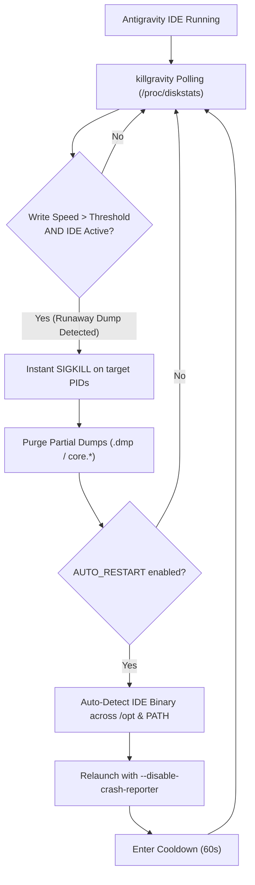

# killgravity

[](LICENSE)
[](#)
[](#)

**killgravity** is a lightweight, zero-dependency Linux daemon and systemd watchdog that protects your storage from runaway core dump loops, catastrophic disk exhaustion, and irreversible NVMe SSD **TBW (Total Bytes Written)** burn caused by Google Antigravity IDE crashes.

It installs a unified CLI executable (`killgravity`) powered by Python 3 with built-in **Model Context Protocol (MCP)** support for Antigravity, giving you full control to manage threshold, timings, systemd service enable/disable, logs, manual killing, and live I/O monitoring.

---

## The Problem

When Google Antigravity IDE (and its underlying Chromium/Electron architecture) crashes, its internal crashpad framework and `systemd-coredump` can enter an aggressive, continuous crash loop. Instead of failing gracefully, each consecutive crash attempts to write a massive **8 GB to 16 GB full memory core dump** directly to disk.

Without an automated watchdog, a system with **200 GB+ of free storage will be completely consumed down to 0 bytes within minutes**, inflicting irreversible **NVMe SSD TBW (Total Bytes Written)** wear and locking up the operating system.

In repeated crash-loops, this causes:
- **Severe SSD Endurance Burn (TBW):** A single 200 GB runaway crash loop burns ~0.2 TB of your drive's manufacturer **Total Bytes Written (TBW)** rating. Repeated dump loops can waste terabytes of endurance in hours, causing permanent premature flash memory wear.
- **Catastrophic Disk Exhaustion:** Unchecked loops consume every remaining gigabyte until the drive reaches **100% full (0 bytes free)**, crashing system services and corrupting files.
- **I/O Lockup & System Freeze:** Writing dumps at maximum NVMe speed (1–3 GB/s) saturates I/O queues, causing the desktop environment and terminal to hang completely.

### Why standard solutions fall short:
1. **Naive `pkill antigravity` scripts** inadvertently terminate the Antigravity Agent, CLI tools, and background hubs (`antigravity-hub`, `drun`, etc.).
2. **Hardcoded binary paths** (e.g. `/opt/antigravity-ide-2.6.0/...`) break whenever the IDE auto-updates to a newer release.
3. **Disabling kernel core dumps** (`sysctl kernel.core_pattern`) does not stop user-space Crashpad instances from attempting to write dump files.

---

## How killgravity Solves It



1. **Kernel-Level I/O Monitoring:** Continuously tracks sector write deltas from `/proc/diskstats` with virtually zero CPU overhead (< 0.1%).
2. **Surgical Process Matching:** Specifically monitors and terminates `antigravity-ide`, preserving other tools and background agent processes.
3. **Sub-2-Second Response:** Triggers within the first 1–2 seconds of a write surge (>500 MB/s), stopping the dump before multi-gigabyte files hit the disk.
4. **Artifact Cleanup:** Cleans up leftover `.dmp` and `core.*` files in `~/.config/Antigravity/Crashpad/` and `/tmp`.
5. **Dynamic Version Auto-Detection:** Automatically discovers updated IDE installations (e.g. `/opt/antigravity-ide-*` or `PATH`) and relaunches them with `--disable-crash-reporter`.
6. **Systemd Coredump Drop-in:** Provides systemd configuration (`99-killgravity.conf`) to suppress storage of system coredumps.

---

## Quick Start (Unified Installer)

A single script (`install.sh`) handles both installation and uninstallation:

```bash
git clone https://github.com/Amazing-Stardom/killgravity.git
cd killgravity
```

### Install in User Mode (Rootless, Recommended)
Installs to `~/.local/bin/` and configures a `systemd --user` service. No sudo required:
```bash
./install.sh --user
```

### Install System-Wide
Installs to `/usr/local/bin/`, `/etc/killgravity/`, sets up a system service, and installs the coredump suppression drop-in:
```bash
sudo ./install.sh --system
```

### Uninstall
The same script handles removal:
```bash
./install.sh uninstall

# Or to also purge configuration files:
./install.sh uninstall --purge
```

---

## Complete Management via CLI

Once installed, the `killgravity` command provides a unified interface to control everything without needing manual systemd or configuration editing:

### 1. Service Control & Auto-Start (Enable / Disable)

| Command | Description | When to Use |
|---------|-------------|-------------|
| `killgravity status` | Live status dashboard | Check if service is active, running PIDs, and current NVMe I/O rate |
| `killgravity enable` | Enable on boot/login | **Recommended default:** keeps your drive and TBW protected automatically |
| `killgravity disable` | Disable auto-start | Turn off background auto-start if you only want to run it manually |
| `killgravity start` | Start daemon service | Resume real-time watchdog monitoring |
| `killgravity stop` | Pause daemon service | **Temporary debugging:** pause the guard if you intentionally need to capture a full core dump |
| `killgravity restart` | Restart daemon | Manually reload the watchdog daemon |
| `killgravity logs -f` | Stream journal logs | View real-time trigger events, alerts, and restart logs |

```bash
# Check overall health and live I/O speed
killgravity status

# Enable to run in background automatically on every login/boot
killgravity enable

# Temporarily pause if you need to capture a dump for debugging
killgravity stop

# Resume active protection
killgravity start
```

### 2. Threshold Management
View or change the disk write trigger threshold:
```bash
# View current threshold
killgravity threshold

# Set threshold in Megabytes per second (e.g., 500 MB/s)
killgravity threshold 500M

# Set threshold in Gigabytes per second (e.g., 1 GB/s)
killgravity threshold 1G

# Set raw sectors per interval
killgravity threshold 1000000
```
*(Changing threshold automatically updates your configuration and restarts the active service).*

### 3. Time & Interval Management
Manage polling rates, cooldowns, and restart delays:
```bash
# View current timing settings
killgravity time

# Set poll interval to 3 seconds
killgravity interval 3

# Set cooldown duration to 90 seconds (prevents restart loops)
killgravity cooldown 90

# Set restart delay before relaunching IDE to 5 seconds
killgravity time delay 5
```

### 4. Process Target & Auto-Restart
```bash
# View or change target regex (default: antigravity-ide)
killgravity target antigravity-ide

# Toggle automatic IDE relaunching after terminating a dump
killgravity auto-restart on
killgravity auto-restart off
```

### 5. Diagnostics & Manual Operations
```bash
# Diagnostic probe to verify /proc/diskstats read and process matching
killgravity test

# Emergency manual kill of active target processes
killgravity kill

# Purge leftover crashpad (.dmp) and core dump files
killgravity clean

# View or edit configuration directly
killgravity config
killgravity config edit
```

---

## Configuration Reference

Configuration is stored at `~/.config/killgravity/killgravity.conf` (User mode) or `/etc/killgravity/killgravity.conf` (System mode).

| Parameter | Default | Description |
|-----------|---------|-------------|
| `TARGET_PATTERN` | `"antigravity-ide"` | Process pattern to match (keeps agent/hub safe) |
| `WRITE_THRESHOLD_SECTORS` | `1000000` | Write speed trigger (~500 MB/s over 2s) |
| `POLL_INTERVAL` | `2` | Polling interval in seconds |
| `AUTO_RESTART` | `true` | Automatically relaunch IDE after kill |
| `RESTART_BIN` | `""` | Binary path (empty for auto-detection) |
| `RESTART_FLAGS` | `"--disable-crash-reporter"` | Flags applied on relaunch |
| `RESTART_DELAY` | `5` | Seconds to wait before relaunching |
| `COOLDOWN_SECONDS` | `60` | Cooldown period after restart |
| `CLEANUP_DUMPS` | `true` | Purge `.dmp` and `core.*` artifacts on kill |

---

## Verification & Testing

Run the automated test suite:
```bash
make test
```
Or directly:
```bash
./tests/test_detection.sh
```

---

## Code Review & Safety Audit

Prior to the v1.0.0 release, this codebase underwent automated review cycles using **`git-lrc`** ([LiveReview](https://livereview.hexmos.com)) and pre-release security auditing (`make audit`).

Detailed audit notes and remediations are documented in [**`docs/reviewlog/git-lrc-review-log.md`**](docs/reviewlog/git-lrc-review-log.md).

---

## License

This project is open-source software licensed under the [MIT License](LICENSE).

Copyright (c) 2026 Ganesh Kumar.
